<p align="center">
  
</p>

# Comics

一款使用 Flutter 构建的第三方漫画阅读客户端，以拷贝漫画内容服务为数据源，提供发现、排行、搜索、书架与多模式阅读体验。界面采用 Cupertino 风格，并通过液态玻璃组件适配浅色与深色外观。

> [!IMPORTANT]
> 本项目为非官方客户端，仅供学习与技术交流。项目与拷贝漫画及其运营方无隶属、合作或授权关系；内容版权归原作者及相关权利人所有。

## 界面预览

<div align="center">
  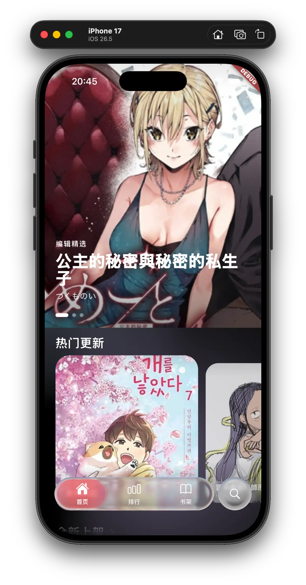
  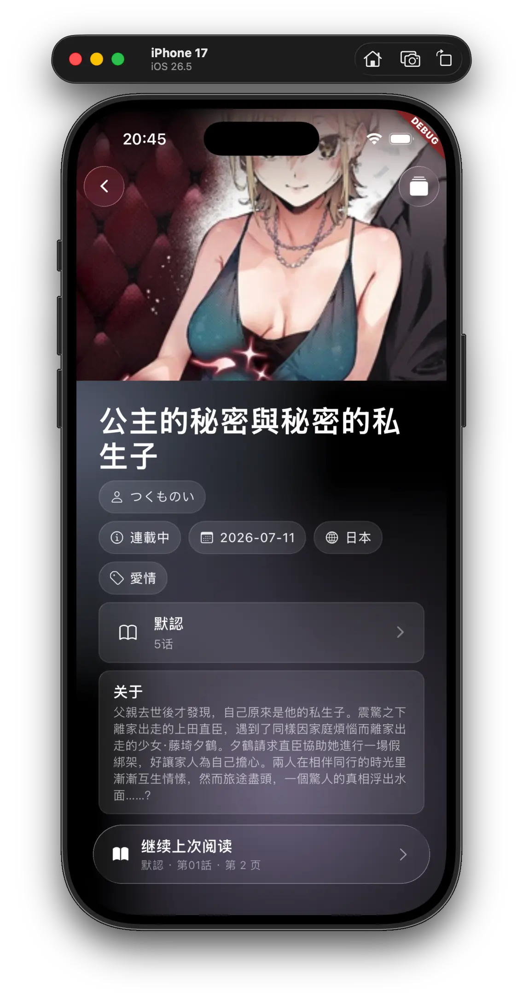
  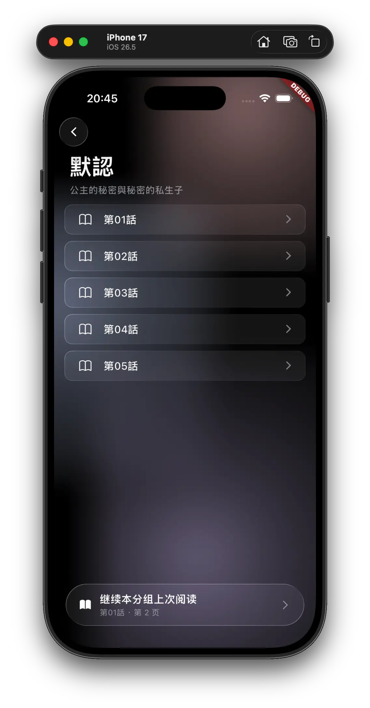
  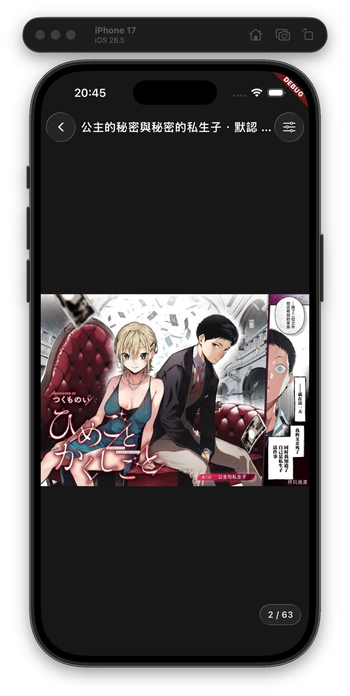
  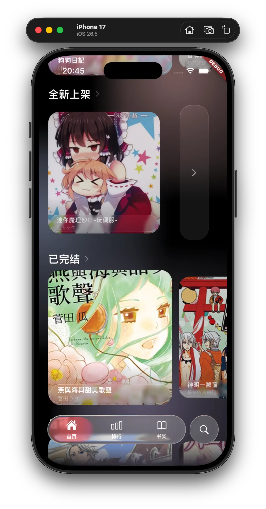
  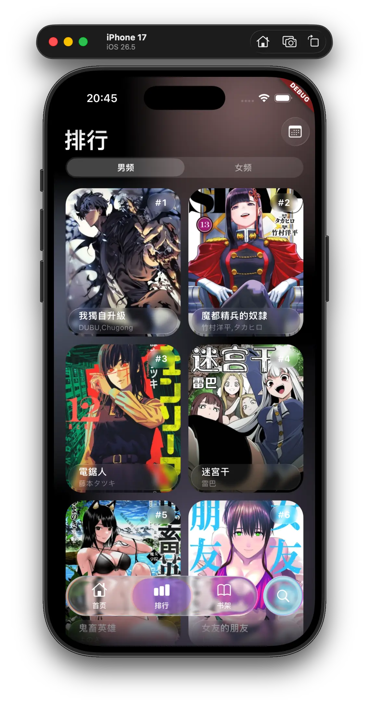
  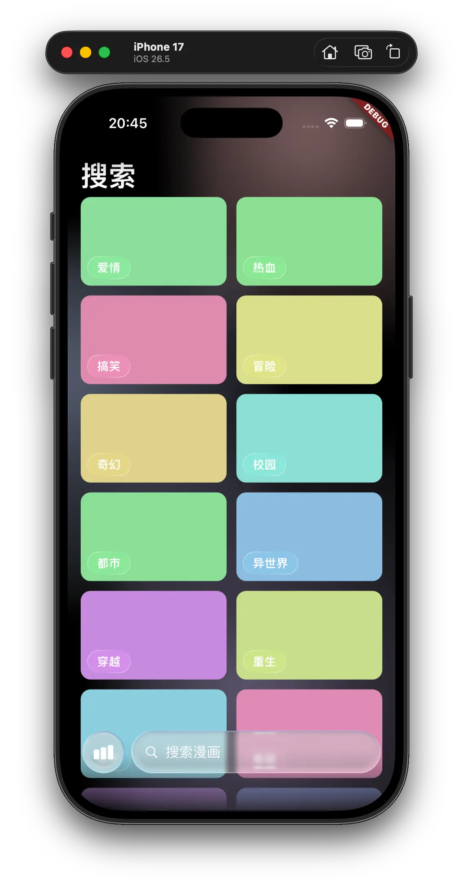
  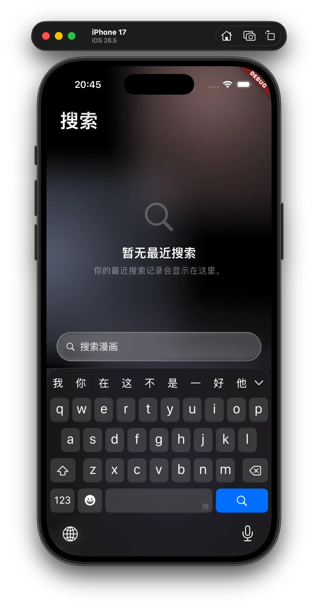
</div>

<details>
<summary>查看更多截图</summary>

<br>

<div align="center">
  
  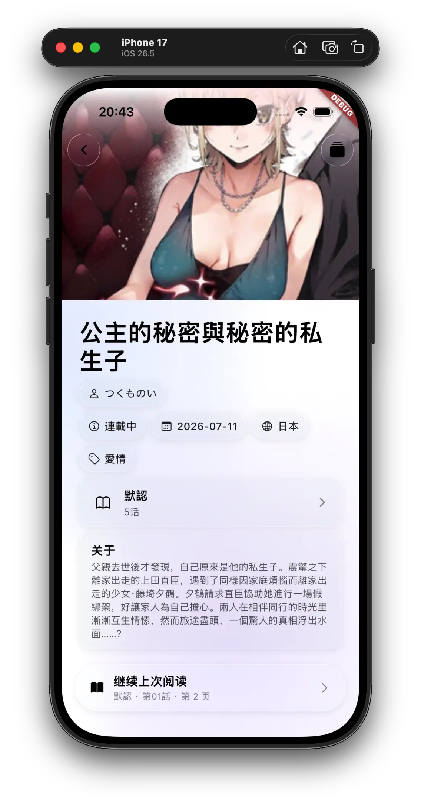
  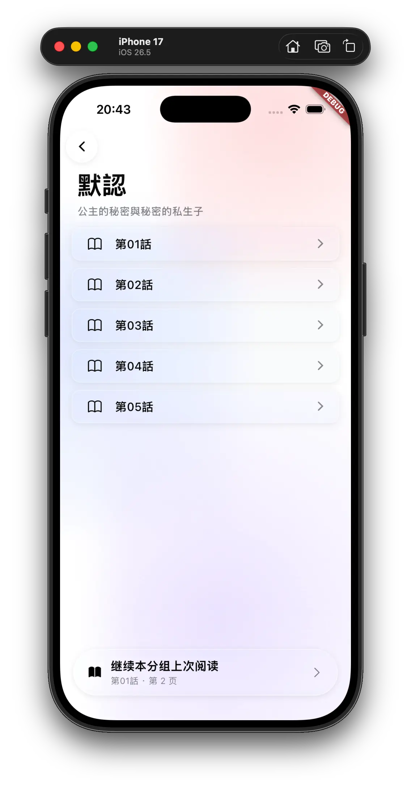
  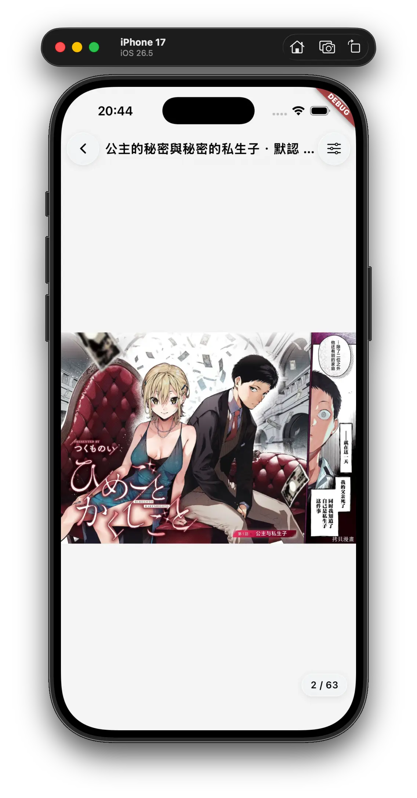
  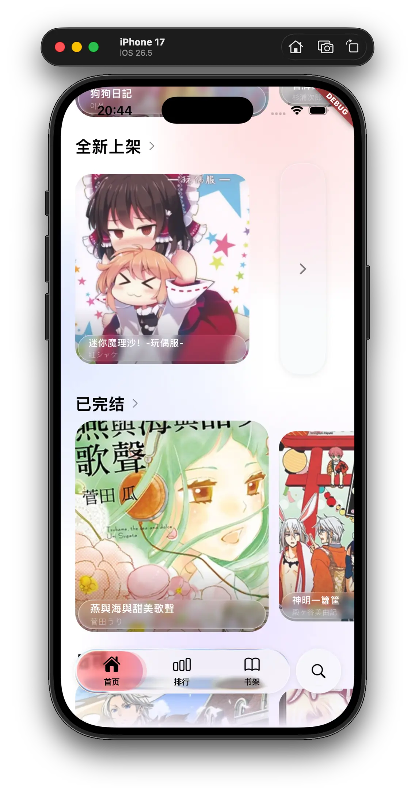
  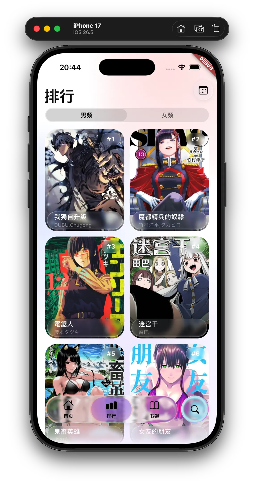
  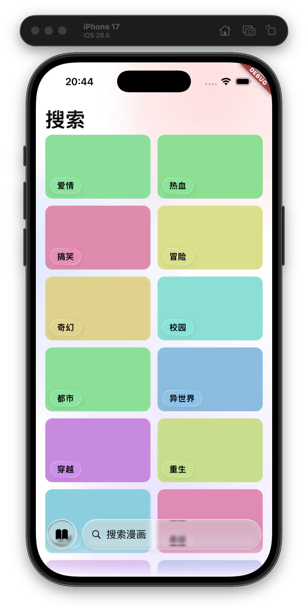
  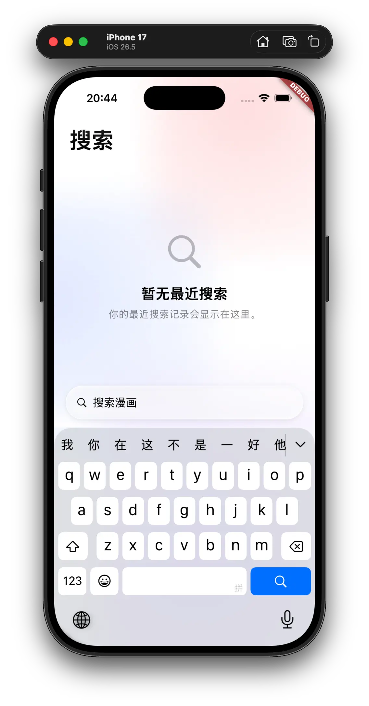
</div>
</details>

## 功能

- 首页推荐、热门更新、全新上架与完结作品
- 日榜、周榜与月榜浏览
- 关键词搜索、分类检索与搜索历史
- 本地书架和阅读历史
- 漫画详情、章节分组与阅读进度记录
- 条漫、翻页和日漫三种阅读模式
- 浅色、深灰与纯黑阅读背景
- 浅色/深色外观与液态玻璃交互界面

## 快速开始

### 环境要求

- Flutter SDK（需包含 Dart 3.12.2 或更高版本）
- 对应目标平台的 Flutter 开发环境
- 可访问内容服务的网络连接

### 获取并运行

```bash
# 克隆仓库
git clone https://github.com/halifox/comics.git
cd comics

# 安装依赖
flutter pub get

# 生成 Retrofit、Freezed、JSON 与 Drift 相关代码
dart run build_runner build --delete-conflicting-outputs

# 运行应用
flutter run
```

仓库已经包含当前生成的代码；当数据模型、API 或数据库定义发生变化时，需要重新执行代码生成。

## 技术栈

- **UI 框架** — Flutter / liquid_glass_widgets
- **状态管理** — Riverpod / Flutter Hooks
- **网络请求** — Dio / Retrofit
- **数据模型** — Freezed / json_serializable
- **本地存储** — Drift / Shared Preferences
- **图片加载** — cached_network_image
- **分页加载** — riverpod_paging_utils

## 贡献

欢迎提交 Issue 和 Pull Request。提交代码前，请遵循仓库中的 [AGENTS.md](AGENTS.md) 协作约束。

## 许可证

本项目遵循 [GPL-3.0 License](LICENSE)。
